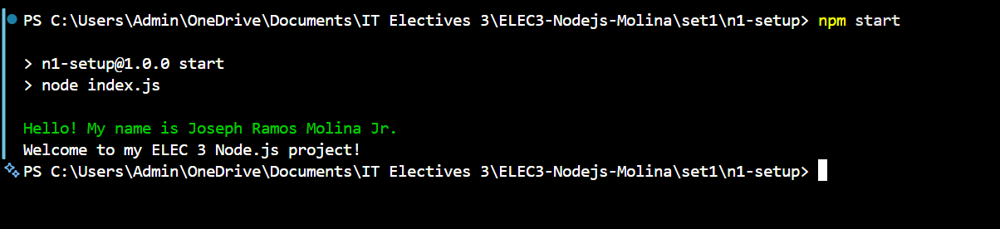
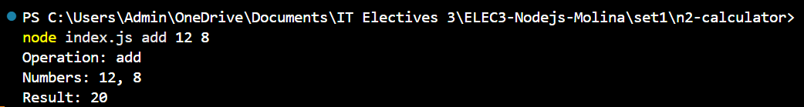
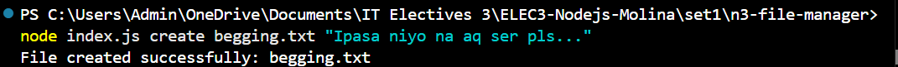

# ELEC 3 - Node.js

## Student Information

- **Name:** JOSEPH RAMOS MOLINA JR.
- **Section:** IV-BSIT B
- **Course:** ELEC 3 - Node.js

## Project Description

This repository contains my individual Node.js programming activities for ELEC 3.

The activities cover different Node.js concepts, including project setup, npm package management, CommonJS modules, mathematical functions, command-line arguments, error handling, and file management using built-in Node.js modules.

## Set 1 - Node.js Fundamentals

- [N1: Project Setup and Package Management](set1/n1-setup/) - A Node.js project that demonstrates npm initialization, package configuration, regular and development dependencies, and executing a JavaScript program using npm start.

- [N2: Modular Calculator](set1/n2-calculator/) - A command-line calculator that uses separate JavaScript modules to perform addition, subtraction, multiplication, division, and average calculations. It also handles division by zero, unknown operations, and invalid inputs.

- [N3: File Manager with fs and path](set1/n3-file-manager/) - A command-line file manager that uses the built-in fs and path modules to create, read, update, delete, and list text files. It also displays file information and handles missing files.

## Set 2 - Advanced Node.js

- N4: Server (Pending)
- N5: API (Pending)
- N6: Middleware (Pending)

## How to Run the Programs

### N1 - Project Setup and Package Management

1. Make sure Node.js and npm are installed.
2. Open a terminal in the repository's root folder.
3. Navigate to the N1 activity folder:

   ```powershell
   cd set1/n1-setup
   ```

4. Install the required packages:

   ```powershell
   npm install
   ```

5. Run the program:

   ```powershell
   npm start
   ```

The program displays my name and a welcome message in the terminal.

**Files used:**

- `index.js` - Contains the JavaScript program that displays my name.
- `package.json` - Contains the project information, npm scripts, and dependencies.
- `package-lock.json` - Records the resolved versions of the installed packages.
- `N1_answers.docx` - Contains my written answers about package.json and node_modules.

**Packages installed:**

- `picocolors` - A regular dependency used to display colored text in the terminal.
- `nodemon` - A development dependency used to automatically restart Node.js programs when files change.


### N2 - Modular Calculator

1. Make sure Node.js is installed.
2. Open a terminal in the repository's root folder.
3. Run the following commands depending on the mathematical operation.

**Addition**

```powershell
node set1/n2-calculator/index.js add 12 8
```

**Subtraction**

```powershell
node set1/n2-calculator/index.js subtract 12 8
```

**Multiplication**

```powershell
node set1/n2-calculator/index.js multiply 12 8
```

**Division**

```powershell
node set1/n2-calculator/index.js divide 12 4
```

**Average**

```powershell
node set1/n2-calculator/index.js average 10 20 30
```

The program receives the operation and numbers through command-line arguments and displays the calculation result.

**Files used:**

- `operations.js` - Contains the five mathematical functions: add, subtract, multiply, divide, and average.
- `formatter.js` - Formats calculation results into readable text.
- `index.js` - Receives command-line arguments, validates inputs, calls the mathematical functions, and displays the results.

The program uses CommonJS modules through `require()` and `module.exports`. It also uses the built-in Node.js `path` module.

**Error Handling**

The calculator provides clear messages when users enter invalid inputs or unsupported operations.

To test division by zero:

```powershell
node set1/n2-calculator/index.js divide 12 0
```

To test an unknown operation:

```powershell
node set1/n2-calculator/index.js power 12 8
```

The program also handles missing numbers and invalid numerical inputs.


### N3 - File Manager with fs and path

1. Make sure Node.js is installed.
2. Open a terminal in the repository's root folder.
3. Run the following commands depending on the file operation.

**Create a Text File**

```powershell
node set1/n3-file-manager/index.js create notes.txt "Hello"
```

**Read a Text File**

```powershell
node set1/n3-file-manager/index.js read notes.txt
```

**Update a Text File**

```powershell
node set1/n3-file-manager/index.js update notes.txt "Additional information"
```

**Delete a Text File**

```powershell
node set1/n3-file-manager/index.js delete notes.txt
```

**List All Text Files**

```powershell
node set1/n3-file-manager/index.js list
```

The program stores and manages text files inside the `files` folder.

**File used:**

- `index.js` - Contains the five file-management operations using the built-in fs and path modules.

**Required Text Files:**

- `history.txt` - Contains the third sample text.
- `notes.txt` - Contains the original text and appended information.
- `sample.txt` - Contains the second sample text.

The program uses `fs.writeFileSync()`, `fs.readFileSync()`, `fs.appendFileSync()`, `fs.unlinkSync()`, and `fs.readdirSync()` to manage files.

It also uses `path.join()`, `path.basename()`, and `path.extname()` to construct and display file information.

**Error Handling**

The program displays a clear message when the user tries to read or delete a file that does not exist.

Example:

```powershell
node set1/n3-file-manager/index.js read missing.txt
node set1/n3-file-manager/index.js delete missing.txt
```

## Screenshots

### N1 - Project Setup and Package Management

**Node.js and npm Version Check**

[View N1 Version Check](set1/n1-setup/screenshots/N1_01_Version_Check.png)

**Completed package.json**

[View N1 Package JSON](set1/n1-setup/screenshots/N1_02_Package_JSON.png)

**Successful npm start Execution**




### N2 - Modular Calculator

**Addition**



**Subtraction**

[N2 Subtraction Result](set1/n2-calculator/screenshots/N2_02_Subtraction.png)

**Multiplication**

[N2 Multiplication Result](set1/n2-calculator/screenshots/N2_03_Multiplication.png)

**Division**

[N2 Division Result](set1/n2-calculator/screenshots/N2_04_Division.png)

**Average**

[N2 Average Result](set1/n2-calculator/screenshots/N2_05_Average.png)

**Division by Zero**

[N2 Division by Zero Error](set1/n2-calculator/screenshots/N2_06_Division_By_Zero.png)

**Unknown Operation**

[N2 Unknown Operation Error](set1/n2-calculator/screenshots/N2_07_Unknown_Operation.png)


### N3 - File Manager with fs and path

**Create Text File**



**Read Text File**

[N3 Read File](set1/n3-file-manager/screenshots/N3_02_Read.png)

**Update Text File**

[N3 Update File](set1/n3-file-manager/screenshots/N3_03_Update.png)

**Delete Text File**

[N3 Delete File](set1/n3-file-manager/screenshots/N3_04_Delete.png)

**List Text Files**

[N3 List Files](set1/n3-file-manager/screenshots/N3_05_List.png)

**File Not Found Error Handling**

[N3 File Not Found](set1/n3-file-manager/screenshots/N3_06_File_Not_Found.png)

## Written Answers

### N1 - Project Setup and Package Management

[N1 Written Answers](set1/n1-setup/N1_answers.docx)

## Development Status

- **N1:** Program tested successfully; files and documentation prepared.
- **N2:** Calculator functionality tested successfully; Git documentation and submission verification in progress.
- **N3:** All five file-management operations tested successfully; GitHub documentation and final commit in progress.